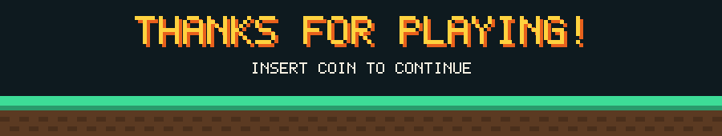

<div align="center">



<br>

<a href="https://arikusuma-wardana.my.id/"></a>
<a href="https://linkedin.com/in/arikusuma-wardana"></a>
<a href="https://instagram.com/arikusuma.05"></a>
<a href="mailto:arikusumawardana09@gmail.com"></a>


<br><br>


</div>

## 🕹️ Player Select

<div align="center">
  
</div>

<br>

Hi, I'm **Arik**, an Informatics student at **Primakara University**. I build websites that feel alive, make small games in Unity, and lately I'm grinding through machine learning. If a project has motion, sound, or a little bit of game feel, I'm interested.

```js
const arik = {
  mainQuest: "Full-stack web, modern frameworks, interactive UIs",
  sideQuest: "Games in Unity + C#",
  grinding:  "Machine Learning",
  lootbox:   ["J-Rock", "Electro House", "one more match before bed"],
  openTo:    ["collabs", "internships", "good conversations"],
};
```

<div align="center">
  
</div>

<br>

## 🎒 Inventory

> Click a slot to open it.

<details open>
<summary><b>⚔️ Frontend</b> · what people see and click</summary>
<br>


</details>

<details>
<summary><b>🛡️ Backend & Database</b> · where the data lives</summary>
<br>


</details>

<details>
<summary><b>🎮 Game Dev</b> · where the fun is</summary>
<br>


</details>

<details>
<summary><b>🔧 Tools & Deployment</b> · how it ships</summary>
<br>


</details>

<br>

## 🐍 Score Board

<div align="center">

<picture>
  <source media="(prefers-color-scheme: dark)" srcset="./assets/github-contribution-grid-snake-dark.svg">
  <source media="(prefers-color-scheme: light)" srcset="./assets/github-contribution-grid-snake.svg">
  
</picture>

<sub>The snake eats my real contribution graph. It respawns daily through GitHub Actions.</sub>

<br><br>


</div>

<br>

## 📬 Join My Party

<details>
<summary><b>💬 Got a project, an idea, or just want to chat? Open this</b></summary>
<br>

| If you want to... | Reach me via |
| :-- | :-- |
| See my work | [arikusuma-wardana.my.id](https://arikusuma-wardana.my.id/) |
| Talk work or collabs | [LinkedIn](https://linkedin.com/in/arikusuma-wardana) |
| Say hi, casually | [Instagram @arikusuma.05](https://instagram.com/arikusuma.05) |
| Send something longer | [arikusumawardana09@gmail.com](mailto:arikusumawardana09@gmail.com) |

</details>

<details>
<summary><b>🎵 Got a song for my playlist?</b></summary>
<br>

If it sounds like rain on a train window or a festival at 2 AM, I'll probably like it. Send it over by [email](mailto:arikusumawardana09@gmail.com) or Instagram.

</details>

<br>

<div align="center">
  
</div>
